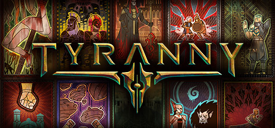

**Tyranny is the morally subversive RPG where you serve the victorious evil overlord Kyros as a Fatebinder dispensing judgment in a conquered land. Features a unique Favour/Wrath relationship system and spellcrafting that lets you combine sigils for custom magic.**

---

## 📖 About

Tyranny is the morally subversive RPG where you serve the victorious evil overlord Kyros as a Fatebinder dispensing judgment in a conquered land. Features a unique Favour/Wrath relationship system and spellcrafting that lets you combine sigils for custom magic.

## ⚠️ Problems Without Trainer

| Problem | Status |
|---------|--------|
| **Spellcrafting Complexity** — Building effective spells from sigil combinations requires experimentation | ✅ Solved |
| **Reputation Consequences** — Faction choices create major story branch locks earlier than expected | ✅ Solved |
| **Short Campaign** — Core story is shorter than comparable CRPGs at 25-30 hours | ✅ Solved |
| **Combat System Depth** — Dual-wielding and combo attack chains require extensive practice | ✅ Solved |

## ✅ Solution

The **Tyranny Trainer** solves all these issues by giving you complete control over the game.

## 🎯 Full Feature List

- Unlimited Resources
- God Mode / Invincibility
- Instant Skill Cooldown
- One-Hit Kill
- Freeze Game Timer
- Unlock All Items & Achievements
- Custom Speed Multiplier
- Save State Anywhere

## 🚀 Quick Start

1. **Disable Windows Defender** temporarily (trainer may trigger false positive)
2. Download the trainer from the button above
3. Launch Tyranny
4. Run the trainer as Administrator
5. Activate desired cheats with hotkeys

## 💎 Free vs Paid

| Feature | Free | Pro |
|---------|------|-----|
| Basic God Mode | ✅ | ✅ |
| Unlimited Resources | ✅ | ✅ |
| All Advanced Cheats | ❌ | ✅ |
| Auto-Updates | ❌ | ✅ |
| Priority Support | ❌ | ✅ |

## 💻 Requirements

- Windows 10/11 (64-bit)
- Tyranny (any version)
- .NET Framework 4.8+
- DirectX 11+

## 🍎 macOS

macOS users can use our alternative tool:

## ⚖️ Legal

This trainer is for educational and single-player use only. Use responsibly.

---

